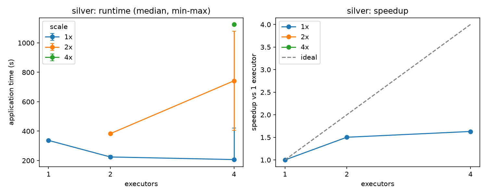
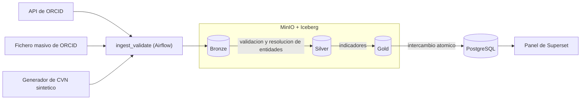

<div align="center">

# Open CVN

**Esquema de datos abierto para curriculos academicos (basado en el CVN espanol) y plataforma lakehouse autoalojada para integrarlos y analizarlos.**

[](https://github.com/holt00/TFG-open-cvn-schema/actions/workflows/pr-tests.yml)


[](LICENSE)


[Solo TFG](TFG.md) ·
[Solo TFM](TFM.md) ·
[Memorias (PDF)](#memorias) ·
[Puesta en marcha](#puesta-en-marcha) ·
[Arquitectura](#arquitectura-del-tfm) ·
[Resultados](#resultados) ·
[Estructura](#estructura-del-repositorio) ·
[Documentacion](#documentacion) ·
[Contribuir](CONTRIBUTING.md)



</div>

---

## Que es

Elaborar, mantener y adaptar un curriculo academico sigue consumiendo mucho
tiempo, y la ausencia de una definicion de bajo nivel clara del CVN dificulta
construir herramientas abiertas e interoperables. Este repositorio ataca el
problema en dos etapas sobre la misma base de codigo, ambas de la Universidad de
Castilla-La Mancha (ESIIAB):

| | Trabajo | Que aporta | Estado |
| --- | --- | --- | --- |
| **TFG** | Trabajo de Fin de Grado | Formato abierto **Open CVN JSON** y las herramientas para generarlo, validarlo, almacenarlo y exportarlo | Terminado y defendido |
| **TFM** | Trabajo de Fin de Master | Plataforma **lakehouse** sobre Kubernetes que integra CVN sintetico y datos reales de ORCID y calcula indicadores de investigacion | Terminado y defendido |

El TFM construye sobre el TFG sin sustituirlo: reutiliza su esquema, su
validador y sus modelos de dominio. Cada trabajo tiene su propio punto de
entrada y se puede usar por separado:

- **[`TFG.md`](TFG.md)**: esquema, parser/validador y aplicacion CLI. Solo
  necesita Python y `uv`.
- **[`TFM.md`](TFM.md)**: plataforma lakehouse. El codigo y las pruebas se
  usan sin cluster; la plataforma completa necesita Kubernetes.

## Caracteristicas

- **Esquema generado, no escrito a mano**: modelos Pydantic y JSON Schema salen
  del paquete oficial CVN XML/XSD de la FECYT con un pipeline reproducible por
  capas.
- **Importacion desde PDF, XML y JSON** con un contrato unico de
  parser/validador y un formato canonico (`schemas/open_cvn.schema.json`).
- **Aplicacion CLI local** con SQLite, versiones maestras y derivadas de un
  curriculo y exportacion a LaTeX/PDF.
- **Lakehouse en capas bronze / silver / gold** sobre MinIO + Apache Iceberg,
  procesado con Spark y orquestado con Airflow.
- **Resolucion de entidades determinista** entre fuentes, evaluada contra la
  verdad de referencia del generador sintetico.
- **Indicadores publicados a PostgreSQL** con intercambio atomico y un panel de
  Superset sobre agregados, sin nombres personales.
- **Benchmark de Spark reproducible** segun numero de ejecutores y escala de
  datos, con comprobacion de que la salida es identica entre configuraciones.

## Arquitectura del TFM



| Capa | Tecnologia | Codigo / configuracion |
| --- | --- | --- |
| Cluster | k3s (local) | `infra/k3s/` |
| Almacenamiento | MinIO + Apache Iceberg (catalogo Hadoop) | `infra/helm-values/`, `infra/spark-conf/` |
| Procesamiento | Apache Spark (`spark-submit`) | `src/tfm_lakehouse/spark_jobs/` |
| Orquestacion | Apache Airflow (`KubernetesExecutor`) | `dags/` |
| Servicio | PostgreSQL + Apache Superset | `infra/superset/` |

Dos DAGs recorren el flujo: `ingest_validate` aterriza las tres fuentes en
bronze con un sobre de procedencia, y `transform_publish` lleva bronze a silver,
silver a gold y gold a PostgreSQL. Los indicadores son publicaciones por
investigador y ano, linea temporal de afiliaciones y pares de colaboracion.

## Resultados

- **Resolucion de entidades** (10.000 documentos): la regla R1 alcanza el 100 %
  de precision; la regla R2 un 95,8 % de precision y un 74,2 % de cobertura
  sobre 186 documentos evaluables.
- **Escalado de Spark** (1, 2 y 4 ejecutores; datos a 1x, 2x y 4x): la fase
  bronze -> silver pasa de 337 s a 207 s con 4 ejecutores (aceleracion 1,63x,
  eficiencia 0,41). Las fases de gold y publicacion apenas mejoran porque su
  coste esta dominado por el arranque y no por el calculo. La salida es
  identica entre numeros de ejecutores.
- **Memoria de ejecutores**: silver agota la memoria con 1 ejecutor a 2x de
  datos y con 1 o 2 ejecutores a 4x; el limite es determinista y esta
  documentado.

Tablas completas, metodo y graficas en [`docs/benchmark/`](docs/benchmark/results.md).

## Puesta en marcha

Requisitos: [`uv`](https://docs.astral.sh/uv/) y Python 3.14.

```bash
git clone https://github.com/holt00/TFG-open-cvn-schema.git
cd TFG-open-cvn-schema
uv sync --group codegen --group testing
uv pip install -e .
uv run pytest -n auto tests
```

Con eso ya se puede usar el pipeline CVN, el parser/validador y la aplicacion
CLI. Para ir mas lejos:

| Quiero... | Guia |
| --- | --- |
| Regenerar todo el pipeline CVN desde el XSD | [`regeneration_workflow.md`](docs/development/regeneration_workflow.md) |
| Importar y validar un CVN (PDF, XML o JSON) | [`parser_workflow.md`](docs/development/parser_workflow.md) |
| Usar la aplicacion CLI de curriculos | [`application_mvp_workflow.md`](docs/development/application_mvp_workflow.md) |
| Levantar la plataforma lakehouse de principio a fin | [`tfm_lakehouse_workflow.md`](docs/development/tfm_lakehouse_workflow.md) |

> [!IMPORTANT]
> La plataforma lakehouse necesita WSL2 con systemd, Docker, `kubectl` y `helm`.
> Los DAGs de Airflow fijan en `REPO_ROOT` la ruta del repositorio: al clonarlo
> en otra ruta hay que editarla en `dags/ingest_validate.py` y
> `dags/transform_publish.py` (se explica en la guia del lakehouse).

## Estructura del repositorio

```text
src/
  cvn_codegen/      pipeline de generacion (normalizacion, politica semantica, modelos)
  generated/        bindings estructurales generados (no se editan a mano)
  models/cvn/       modelos de dominio generados y componentes compartidos
  open_cvn/         parser/validador y formato canonico Open CVN JSON
  open_cvn_app/     aplicacion CLI local (SQLite, versiones, LaTeX/PDF)
  tfm_lakehouse/    ingesta, silver, gold, trabajos Spark y benchmark del TFM
dags/               DAGs de Airflow (ingest_validate, transform_publish)
infra/              k3s, Helm values, configuracion de Spark y Superset
schemas/            JSON Schema de Open CVN
examples/           ejemplos de documentos Open CVN
tests/              suite de pruebas
docs/               arquitectura, workflows, roadmap y benchmark
```

## Documentacion

| Tema | Documento |
| --- | --- |
| Guia principal del proyecto | [`PROJECT_GUIDE.md`](PROJECT_GUIDE.md) |
| Indice de contexto | [`docs/context/project_context_index.md`](docs/context/project_context_index.md) |
| Estado actual (TFM) | [`docs/context/tfm/current_status.md`](docs/context/tfm/current_status.md) |
| Roadmap y epic del TFM (`#89`) | [`tfm_roadmap.md`](docs/roadmap/tfm/tfm_roadmap.md) |
| Estado del arte y justificacion tecnologica | [`estado_del_arte_tfm.md`](docs/research/tfm/estado_del_arte_tfm.md) |
| Arquitectura del pipeline CVN (TFG) | [`cvn_pydantic_generation_pipeline.md`](docs/pipeline/cvn_pydantic_generation_pipeline.md) |
| Diagramas conceptuales | [`docs/diagrams/`](docs/diagrams/README.md) |
| Limitaciones conocidas | [`known_limitations.md`](docs/pipeline/known_limitations.md) |
| Decisiones de arquitectura | [`docs/adr/`](docs/adr/) |

<details>
<summary><b>Como se construyo el TFG (pipeline por capas)</b></summary>

1. bindings Pydantic estructurales generados desde el paquete oficial CVN
   XML/XSD (`src/generated/`)
2. normalizacion que indexa cada campo por su codigo CVN y lo resuelve contra
   los catalogos auxiliares (`src/cvn_codegen/normalization.py`)
3. politica semantica con decisiones deterministas de tipado y nomenclatura
   (`src/cvn_codegen/semantic_policy.py`)
4. generador de modelos de dominio (`src/cvn_codegen/domain_model_generator.py`,
   salida en `src/models/cvn/generated/`)
5. modelo conceptual agnostico del que salen los diagramas y el JSON Schema
   (`docs/diagrams/`, `schemas/open_cvn.schema.json`)
6. formato canonico Open CVN JSON y contrato unificado de parser/validador con
   importacion desde PDF, XML y JSON (`src/open_cvn/`)
7. aplicacion CLI con SQLite, versiones maestras/derivadas, exportacion a
   LaTeX/PDF e importacion opcional asistida por LLM (`src/open_cvn_app/`)

Su registro (issues `#11` a `#71`) esta cerrado en
[`docs/context/tfg/current_status.md`](docs/context/tfg/current_status.md) y
[`docs/roadmap/tfg/cvn_generation_roadmap.md`](docs/roadmap/tfg/cvn_generation_roadmap.md).

</details>

## Estado del proyecto

- **TFG**: cerrado (issues `#11`-`#71`).
- **TFM**: cerrado y defendido (issues `#90`-`#103`).

Las limitaciones conocidas estan en
[`docs/pipeline/known_limitations.md`](docs/pipeline/known_limitations.md); la
mas visible es la ruta fija `REPO_ROOT` de los DAGs.

## Memorias

| Trabajo | PDF | Fuente LaTeX |
| --- | --- | --- |
| TFG | [`docs/memoria/pdf/TFG.pdf`](docs/memoria/pdf/TFG.pdf) | `docs/memoria/TFG/` |
| TFM | [`docs/memoria/pdf/TFM.pdf`](docs/memoria/pdf/TFM.pdf) | `docs/memoria/TFM/` |

Los PDF se compilan con un DNI ficticio (`00000000X`). La declaracion de autoria
lee el DNI de `include/datos_personales.tex`, fichero local ignorado por git; sin
el, la memoria compila con ese valor. Para usar el propio, copiar
`include/datos_personales.example.tex` a `include/datos_personales.tex` y
editarlo, y no subir el PDF resultante.

## Contribuir

Lee [`CONTRIBUTING.md`](CONTRIBUTING.md) y el orden de lectura de
[`AGENTS.md`](AGENTS.md). Reglas basicas: no se edita `src/generated/` a mano,
la logica del pipeline va en `src/cvn_codegen/`, y cada cambio actualiza su
documentacion en la misma sesion.

## Autoria y licencia

Autor: Carlos Martinez Jaen. Director: Luis De La Ossa Jimenez. Escuela
Superior de Ingenieria Informatica de Albacete (ESIIAB), Universidad de
Castilla-La Mancha.

Licencia GPL-3.0, ver [`LICENSE`](LICENSE). El paquete CVN XML/XSD de
`docs/CvnXML_v1.4.3_2.1_17012025/` es material oficial de la FECYT incluido como
fuente de referencia y no esta cubierto por esa licencia.
