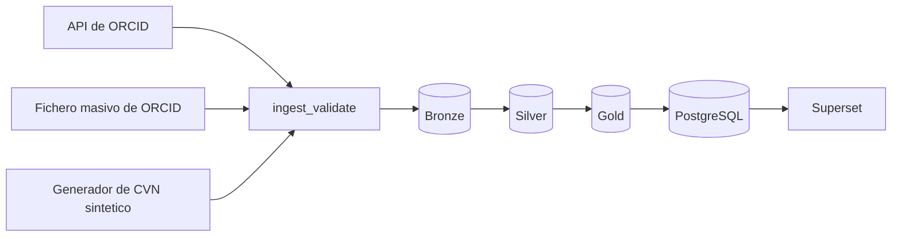

# TFM: plataforma lakehouse para informacion curricular

Punto de entrada para trabajar **con el TFM**. Reutiliza el esquema y el
validador del TFG como dependencia; no hace falta conocer su interior (ver
[TFG.md](TFG.md) si se quiere).

- Memoria (PDF): [`docs/memoria/pdf/TFM.pdf`](docs/memoria/pdf/TFM.pdf)
- Estado: terminado y defendido (issues `#90`-`#103`, epic `#89`).
- Volver al [README](README.md) | Ir al [TFG](TFG.md)

## Que hace

Plataforma lakehouse autoalojada sobre Kubernetes (k3s) que ingiere CVN
sintetico y datos reales de ORCID, los integra con resolucion de entidades y
publica indicadores de investigacion en un panel de Superset.



| Capa | Tecnologia | Codigo / configuracion |
| --- | --- | --- |
| Cluster | k3s | `infra/k3s/` |
| Almacenamiento | MinIO + Apache Iceberg | `infra/helm-values/`, `infra/spark-conf/` |
| Procesamiento | Apache Spark | `src/tfm_lakehouse/spark_jobs/` |
| Orquestacion | Apache Airflow | `dags/` |
| Servicio | PostgreSQL + Superset | `infra/superset/` |

## Puesta en marcha

Hay dos niveles; el primero basta para leer, probar y modificar el codigo.

### 1. Solo el codigo y las pruebas (sin cluster)

Requisitos: [`uv`](https://docs.astral.sh/uv/) y Python 3.14.

```bash
uv sync --group codegen --group testing
uv pip install -e .
uv run pytest -n auto tests
```

Las pruebas de `src/tfm_lakehouse/` (clientes ORCID, generador sintetico,
bronze, silver, gold) no necesitan red ni cluster.

### 2. La plataforma completa

Requiere WSL2 con systemd, Docker, `kubectl` y `helm`. Los pasos van desde el
cluster hasta el panel y el benchmark:
[`tfm_lakehouse_workflow.md`](docs/development/tfm_lakehouse_workflow.md).

> [!IMPORTANT]
> Los DAGs fijan en `REPO_ROOT` la ruta del repositorio. Al clonarlo en otra
> ruta hay que editarla en `dags/ingest_validate.py` y
> `dags/transform_publish.py`.

## Mapa del codigo

| Ruta | Contenido |
| --- | --- |
| `src/tfm_lakehouse/orcid_client/`, `orcid_bulk/` | ingesta de ORCID (API y fichero masivo) |
| `src/tfm_lakehouse/synthetic_cvn/` | generador de CVN sintetico valido contra el esquema |
| `src/tfm_lakehouse/bronze/`, `silver/`, `gold/` | capas del lakehouse |
| `src/tfm_lakehouse/spark_jobs/` | trabajos `spark-submit` |
| `src/tfm_lakehouse/benchmark/` | benchmark de Spark |
| `dags/` | DAGs `ingest_validate` y `transform_publish` |
| `infra/` | k3s, Helm values, Spark y Superset |

## Resultados

- Resolucion de entidades (10.000 documentos): regla R1 con 100 % de
  precision; regla R2 con 95,8 % de precision y 74,2 % de cobertura.
- Benchmark de Spark con 1, 2 y 4 ejecutores: bronze -> silver pasa de 337 s a
  207 s (aceleracion 1,63x); gold y publicacion apenas escalan. La salida es
  identica entre configuraciones.

Detalle en [`docs/benchmark/results.md`](docs/benchmark/results.md).

## Documentacion

- Estado: [`current_status.md`](docs/context/tfm/current_status.md) y
  [`tfm_roadmap.md`](docs/roadmap/tfm/tfm_roadmap.md)
- Epic: [`issue-89`](docs/roadmap/tfm/issues/issue-89-epic-tfm-lakehouse-platform.md)
  y sus issues hijos `#90`-`#103` en `docs/roadmap/tfm/issues/`
- Estado del arte y justificacion tecnologica:
  [`estado_del_arte_tfm.md`](docs/research/tfm/estado_del_arte_tfm.md)
- Benchmark y como reproducirlo: [`docs/benchmark/`](docs/benchmark/README.md)
- Limitaciones conocidas: [`known_limitations.md`](docs/pipeline/known_limitations.md)
